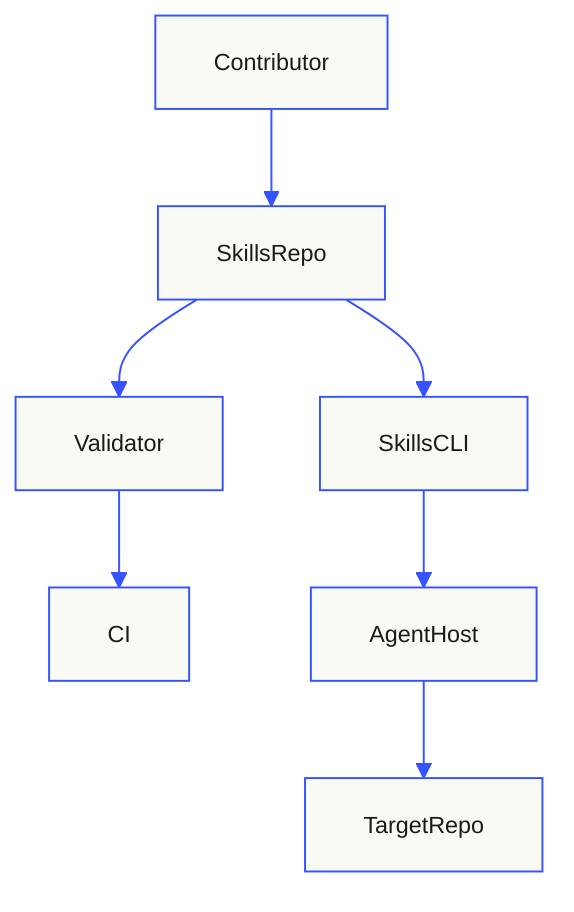
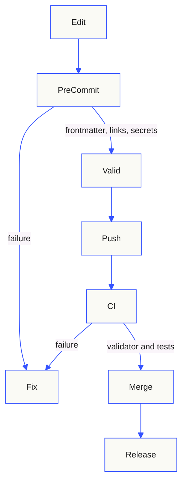
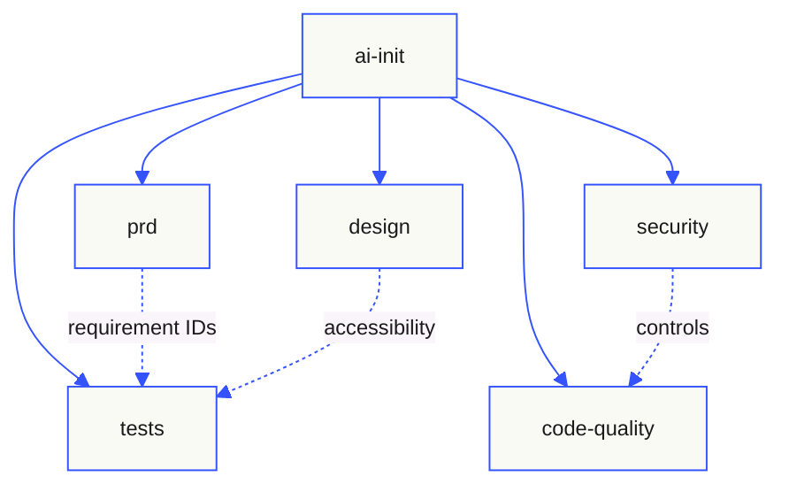

# Architecture

This repository is a collection of six Agent Skills plus the validation and
governance machinery that keeps them loadable and safe. It is documentation and
instruction content, not a running service.

## Context



The repository is consumed in two ways: contributors change it through pull
requests, and users install one or more skill directories with the Skills CLI.
Once installed, a skill is loaded by an agent host and applied to a target
repository.

## Components

| Component | Responsibility | Evidence |
|---|---|---|
| `skills/<name>/SKILL.md` | Entry point, frontmatter, workflow, operating constraints | `skills/*/SKILL.md` |
| `skills/<name>/references/` | Detailed standards loaded on demand | `skills/*/references/` |
| `skills/<name>/templates/` | Output templates copied into target repositories | `skills/*/templates/` |
| `skills/ai-init/files/` | EditorConfig, Git attributes, and pre-commit starters | `skills/ai-init/files/` |
| `evals/` | Trigger and non-trigger evaluation fixtures | `evals/*.yaml` |
| `scripts/validate_skills.py` | Specification and enterprise metadata gate | `scripts/validate_skills.py` |
| `scripts/check_links.py` | Local Markdown link integrity | `scripts/check_links.py` |
| `tests/` | Regression tests for the validators | `tests/` |
| `.github/workflows/validate.yml` | CI enforcement | `.github/workflows/validate.yml` |

## Validation pipeline



The local hook gives fast feedback; CI is authoritative. A release is cut only
from a green commit and a signed tag.

## Progressive disclosure

Each skill keeps its entry point small enough to load on activation and moves
long material into references:

| Tier | Content | Approximate budget |
|---|---|---|
| Catalog | `name` and `description` | 50–100 tokens per skill |
| Instructions | `SKILL.md` body | Under 5,000 tokens and 500 lines |
| Resources | References, templates, files | Loaded only when linked |

This is why the security and test standards live in `references/` rather than
being inlined into every skill body.

## Skill relationship



`ai-init` is the bootstrap coordinator. `prd`, `security`, `design`, `tests`,
and `code-quality` are independent skills; each can be installed alone, so
none may depend on another skill's reference files at load time.

## Repository layout

```text
.
├── .github/                 # CI, Dependabot, pull-request template
├── docs/                    # Governance, standard, threat model, architecture
├── evals/                   # Trigger/non-trigger fixtures per skill
├── scripts/                 # Validators (stdlib + PyYAML)
├── skills/
│   ├── ai-init/             # Bootstrap + document standard + starters
│   ├── prd/                 # Requirements + traceability
│   ├── security/            # Security posture + enterprise controls
│   ├── tests/               # Test work + test standard
│   ├── design/              # Design system + accessibility
│   └── code-quality/        # Cleanup + engineering practices
├── tests/                   # Validator regression tests
├── CHANGELOG.md
├── CONTRIBUTING.md
├── SECURITY.md
└── README.md
```

## Failure modes and design decisions

| Failure mode | Design response |
|---|---|
| Formatter corrupts frontmatter | Strict validator, regression test, pre-commit, CI |
| Agent invents facts or compliance | Evidence taxonomy, status vocabulary, anti-overclaim rules |
| Agent overreaches scope | Operating constraints, scope boundaries, read-only defaults |
| Secrets copied into docs | Explicit prohibition, redaction rule, gitleaks |
| Broken documentation index | Link checker and generation rules that omit skipped docs |
| Skill bloat | Progressive disclosure and body size limits |
| Inconsistent enterprise coverage | Shared standard, per-skill standards metadata, evals |
| Silent regression | Versioned evals, changelog, required review |

## Operational assumptions

- Markdown and YAML are interpreted by agent hosts; no runtime service is
  deployed.
- CI runs on GitHub Actions with read-only repository permissions by default.
- The validator requires Python 3.11 or later and a pinned PyYAML version.
- Local hooks are advisory because they can be bypassed; CI and branch
  protection are the enforcement points.
- The skill content is public; no secrets or private customer data belong in
  this repository.

## Related documents

- [Skill authoring standard](./skill-standard.md)
- [Governance](./governance.md)
- [Threat model](./threat-model.md)
- [Contributing](../CONTRIBUTING.md)
