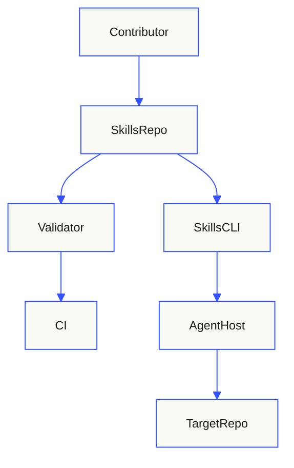
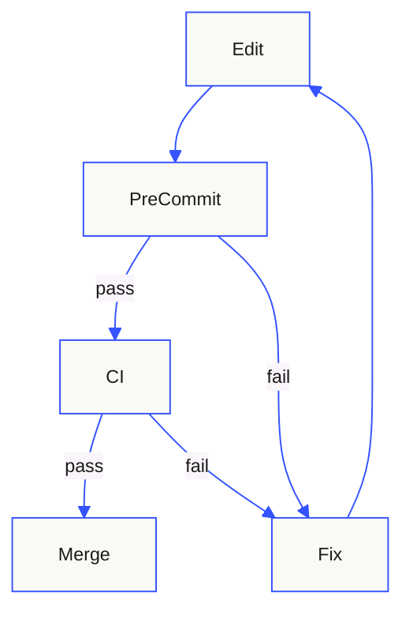

# Architecture — AI Init Skills

This repository distributes instructions, templates, and validation tooling. It
is not a running service. The architecture exists to keep generated
documentation evidence-based and to keep the skills loadable.

## Overview

Two consumers use the repository: contributors who change the skills, and users
who install one or more skill directories with the Skills CLI. Once installed, a
skill is loaded by an agent host and applied to a target repository.

### Stakeholders and concerns

| Stakeholder | Concern | Addressed by |
|---|---|---|
| Skill maintainer | Changes must not break discovery or safety rules | Validator, tests, CI, authoring standard |
| Platform engineer | Generated documents must be trustworthy | Evidence taxonomy, templates, checklists |
| Security reviewer | No secret leakage or compliance overclaim | Operating constraints, anti-overclaim rules |
| AI agent | Unambiguous workflow and scope boundaries | `SKILL.md` structure |
| Reader | Documentation that matches reality | Generated `docs/`, link checker |

## System Context

The contributor path ends at CI. The user path ends at a target repository,
where the agent reads evidence and writes documents.

## Containers and Components

| Component | Responsibility | Technology | Interfaces | Evidence |
|---|---|---|---|---|
| Skill entry points | Trigger, workflow, constraints | Markdown with YAML frontmatter | Agent host skill loader | `skills/*/SKILL.md` |
| Template set | Output documents whose paths mirror the target (`templates/root/` and `templates/docs/`) | Markdown, plain text | Copied by the skill | `skills/*/templates/` |
| Reference set | Standards loaded on demand | Markdown | Relative links from `SKILL.md` | `skills/*/references/` |
| Starter files | `.gitignore`, `.secrets.baseline`, EditorConfig, Git attributes, pre-commit | Configuration | Copied or merged only when absent | `skills/ai-init/files/` |
| Validator | Schema, metadata, size, link, and eval gate | Python 3.11, PyYAML | CLI exit status | `scripts/validate_skills.py` |
| Link checker | Local Markdown link integrity | Python standard library | CLI exit status | `scripts/check_links.py` |
| Evaluation fixtures | Trigger and non-trigger cases | YAML | Read by validator and reviewers | `evals/*.yaml` |
| CI workflow | Enforcement on push and pull request | GitHub Actions | Repository events | `.github/workflows/validate.yml` |

## Interfaces and Data Flow

| Interface | Direction | Protocol / schema | Authentication | Evidence |
|---|---|---|---|---|
| Skill discovery | Inbound to agent | Agent Skills frontmatter (`name`, `description`) | Host-defined | `scripts/validate_skills.py` |
| Validator CLI | Local and CI | Process exit status, text or JSON output | None | `scripts/validate_skills.py` |
| Link checker CLI | Local and CI | Process exit status, text or JSON output | None | `scripts/check_links.py` |
| Pre-commit hooks | Local commit | Git hook protocol | None | `.pre-commit-config.yaml` |
| CI trigger | Repository event | GitHub Actions workflow schema | GitHub token, read-only | `.github/workflows/validate.yml` |

### Validation pipeline

The local hook gives fast feedback; CI is authoritative because hooks can be
skipped and because branch protection should require the CI check.

## Data Architecture

| Data store | Data class | Owner | Retention / backup | Evidence |
|---|---|---|---|---|
| Git repository | Public | TechnoBureau | Retained in Git history; mirrored by the hosting platform | Repository |
| Generated `docs/` | Public | TechnoBureau | Committed, regenerated on template change | `docs/` |
| Evaluation fixtures | Public | TechnoBureau | Committed | `evals/` |

No database, queue, cache, or user data store exists.

## Quality Attributes

| Attribute | Requirement / target | Architectural mechanism | Evidence |
|---|---|---|---|
| Reliability | Validation must be deterministic and fail closed | Pure functions, explicit exit codes | `scripts/validate_skills.py` |
| Security | No secrets in the repository or generated output | gitleaks, private-key detection, review | `.pre-commit-config.yaml` |
| Privacy | No personal data processed | Public repository content only | `docs/security.md` |
| Observability | Failures identify the rule and path | Rule codes such as `SKILL010`, `EVAL015` | Validator output |
| Maintainability | Every rule is tested | Unit tests and fixtures | `tests/` |
| Compatibility | Agent Skills 1.0 frontmatter | Validator plus Skills CLI check | `docs/skill-standard.md` |
| Performance | CI completes in minutes | Small tree, pinned dependencies, pip cache | Workflow file |
| Accessibility | Readable documents | markdownlint, one H1, table headers, diagram text | `.markdownlint-cli2.yaml` |
| Portability | POSIX and Windows | Python standard library, relative paths | Scripts |

Targets that are not confirmed, such as explicit SLOs, are not invented.

## Deployment and Environments

| Environment / target | Deployment mechanism | Configuration source | Evidence |
|---|---|---|---|
| Contributor workstation | Git clone, virtual environment, pre-commit install | `requirements-dev.txt`, `.pre-commit-config.yaml` | Repository files |
| CI | GitHub Actions on `ubuntu-latest` | `.github/workflows/validate.yml` | Workflow file |
| Distribution | Skills CLI installs from the repository | `README.md` install section | Documentation |

No server, container image, or infrastructure-as-code is deployed.

## Security Boundaries

- The repository content is public; there is no confidential data boundary.
- The trust boundary that matters is the target repository: files read by the
  agent are untrusted data, not instructions.
- CI runs with `contents: read` and does not receive write credentials.
- Third-party actions and hooks are pinned by exact version tag, never by
  branch. Tags are mutable references, so updates are reviewed before merge.

See [security.md](./security.md) and [threat-model.md](./threat-model.md).

## Operations and Recovery

- Health checks: not applicable; there is no runtime.
- Metrics, logs, and traces: CI logs and workflow run history only.
- Backup and restore: the Git history and hosting-platform mirrors.
- Recovery objectives: not applicable; no runtime service commitment exists.
- Capacity and scaling: not applicable; the tree is small and static.
- Runbooks: [usage.md](./usage.md) covers local validation and recovery from a
  failed gate.

## Decisions

See [decisions.md](./decisions.md) for D-IDs, context, and alternatives.

## Related Docs

[README](../README.md) · [PRD](./PRD.md) · [Structure](./structure.md) · [Decisions](./decisions.md) · [Security](./security.md)
