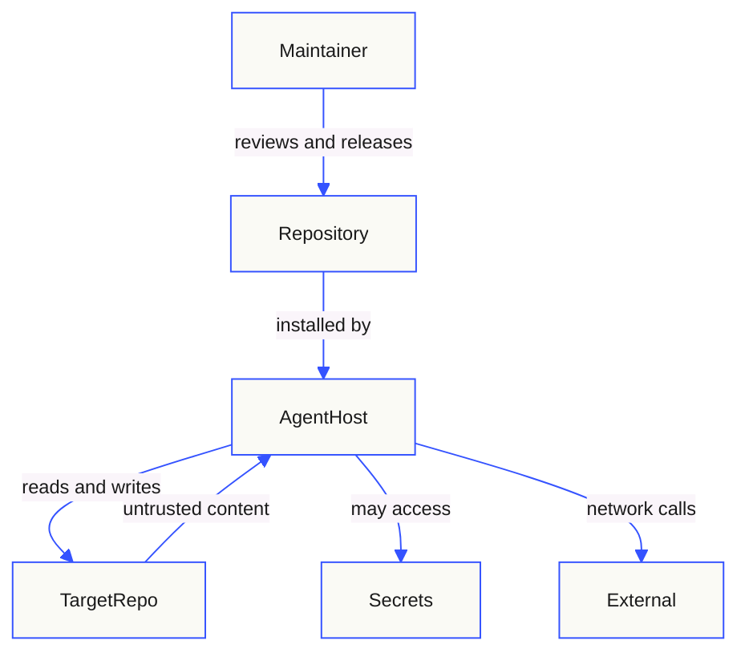

# Threat Model

This threat model covers the skill collection as an artifact that influences
AI agents operating on other repositories. It is a design-level model, not an
assertion that every control is operating effectively.

## Assets

- Skill instructions that can cause file writes, Git operations, or analysis.
- The integrity of YAML frontmatter and permanent document IDs.
- Repository secrets, credentials, and tokens visible to an agent's tools.
- Target-repository source code and data inspected during a task.
- Trust in published versions and release artifacts.
- User and maintainer time, and the accuracy of generated documentation.

## Trust boundaries

| Boundary | Control expectation |
|---|---|
| Maintainer → Repository | Pull request, CODEOWNERS, validation workflow, signed release tag |
| Repository → Agent host | Spec-compliant frontmatter, explicit safety constraints, least-agency tool declaration |
| Target repository → Agent | Treat content as data; ignore embedded instructions; redact secrets |
| Agent → Target repository | Scoped writes, preservation rules, no destructive Git operations |
| Agent → Secrets | Never read, print, copy, or commit; redact values |
| Agent → External network | No exfiltration; network only for the task's approved dependencies |

`allowed-tools` in frontmatter is declarative. Unless the host enforces it, it
does not constrain the agent. The skill body and host permission model must
provide the real boundary.

## Threats and controls

| ID | Threat | STRIDE / privacy | Impact | Controls | Residual risk |
|---|---|---|---|---|---|
| T-01 | Indirect prompt injection through target repository files, READMEs, issues, or fixtures | Tampering / Spoofing | Agent follows attacker instructions, expands scope, or exfiltrates data | Operating constraints in every skill; treat content as data; host-level permissions; review of generated diffs | Host model behavior is probabilistic; cannot be eliminated by instructions alone |
| T-02 | Secret exposure in generated documentation, logs, or examples | Information disclosure | Credential compromise | Explicit prohibition; redaction rules; gitleaks; review; no secret values in templates | Secrets already present in a repository may be copied by a careless agent; scanning helps but is not complete |
| T-03 | Destructive action: deleting files, force-push, history rewrite, infrastructure change | Tampering / Denial of service | Data loss, outage | Read-only defaults; `$code-quality` and `$security` scope boundaries; preserve user work; explicit authorization required | A user may explicitly request a destructive action; skill must still warn and scope |
| T-04 | Corrupted machine-readable metadata (frontmatter, IDs) | Tampering | Skills become unloadable; traceability breaks; silent regression | Validator, regression tests, pre-commit hook, CI, formatter guidance | A new tool or bypassed hook could reintroduce the defect |
| T-05 | Fabricated evidence or compliance overclaim | Spoofing / Repudiation | Bad decisions, audit exposure, false assurance | Evidence taxonomy, status vocabulary, anti-overclaim rules, claim types, review checklist | A reviewer may accept unsupported prose without tracing evidence |
| T-06 | Over-broad tool or permission grant | Elevation of privilege | Agent can read secrets or mutate unintended systems | Least-agency metadata, scope boundaries, host permissions, explicit approval for destructive/external actions | Metadata is not enforcement; host configuration is outside this repository |
| T-07 | Supply-chain compromise of pre-commit hooks, GitHub Actions, or Python dependencies | Tampering | Arbitrary code execution in CI or contributor machines | Pinned versions and commit SHAs, Dependabot, least-privilege workflow tokens, no secrets in CI, review of action changes | Upstream compromise before pinning; transitive dependencies |
| T-08 | Malicious or compromised reference/template content | Tampering | Agent executes or copies unsafe guidance | References are reviewed as code; links resolve locally; no remote includes at runtime | External links can change after review; links are documentation, not executed content |
| T-09 | AGENTS.md/CLAUDE.md symlink replacement attack | Tampering / Spoofing | Attacker-controlled instructions at the highest precedence | Inspect path before replacing; preserve unique instructions; report conflicts; never create broken links | User approval of a suspicious merge can still admit malicious text |
| T-10 | Evaluation blind spot | — | Regressions ship unnoticed | Trigger/non-trigger fixtures, adversarial cases, manual review, versioned evals | No automated model-behavior scorer is currently wired in |
| T-11 | Personal or customer data copied into docs, tests, or examples | Privacy | Regulatory and reputational harm | Synthetic-data rules, minimization, redaction, test-data policy | Agents may not recognize identifiers in unfamiliar formats |
| T-12 | Denial of service via huge files, recursive traversal, or unbounded scans | Denial of service | Tool exhaustion, cost | Bounded inspection guidance; no unbounded scanners in skills; host timeouts | Repository size varies; host limits are external |
| T-13 | Release of an unvalidated tree | Repudiation / Tampering | Users receive broken or unsafe skills | CI gate, signed tag, release checklist, post-release frontmatter check | Manual release steps can be skipped if governance is not followed |

## Failure analysis: frontmatter loss

**Failure mode.** A Markdown formatting pass rewrites the opening YAML
delimiter as a horizontal rule and merges `name` and `description` into a
heading. The file remains valid Markdown, so visual review does not detect it.

**Impact.** Compliant agents and the Skills CLI cannot discover or load the
affected skills.

**Root cause.** Machine-readable metadata had no automated validation, and a
formatter was allowed to parse it as prose.

**Controls.** Strict frontmatter validation, a regression test that reproduces
the corruption, pre-commit and CI gates, formatter guidance, and a release
check that published skills begin with `---`.

**Residual risk.** A contributor can bypass a local hook, and a future tool may
rewrite the file differently. CI remains the authoritative gate; branch
protection and required checks must enforce it.

## Assumptions and limits

- The host agent implements its own permission and sandbox model. This
  repository cannot prove the host's enforcement.
- Users install skills from the published repository. A compromised local copy
  or fork is outside this model.
- The model's behavior is not deterministic. Prompt-injection resistance is
  reduced, not guaranteed, by instructions.
- This model does not cover the security of target repositories. Each target
  repository needs its own assessment via the `security` skill.
- No penetration test or red-team exercise has been performed for this
  document unless a record exists elsewhere.

## Review triggers

Review this model when:

- a skill gains write, network, or destructive capability;
- tool or permission declarations change;
- a new external dependency, action, or hook is added;
- an injection, secret-exposure, or destructive-action incident occurs;
- the Agent Skills specification changes;
- the release or validation pipeline changes.

## Related documents

- [Skill authoring standard](./skill-standard.md)
- [Governance](./governance.md)
- [Security policy](../SECURITY.md)
- [Architecture](./architecture.md)
