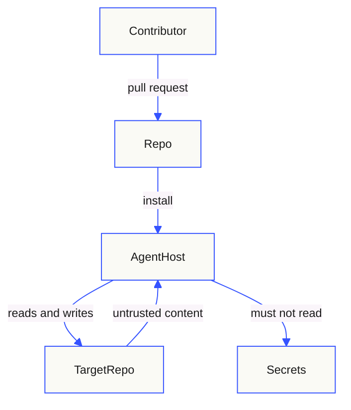

# Threat Model — AI Init Skills

This is a design-level threat model. It records what the collection protects,
where trust changes, and which threats and controls exist. It is not a
penetration test, an audit opinion, or proof that a control operates
effectively.

## Scope and assumptions

- Assessed components: skill instructions, templates, references, validator,
  link checker, tests, evaluation fixtures, CI workflow.
- Environments: contributor workstation and GitHub Actions.
- Out of scope: the target repository a skill is applied to, the agent host's
  sandbox, and platform-level GitHub settings.

Assumptions:

- The agent host implements its own permission model; this repository cannot
  prove it.
- Installed copies come from the official repository or a reviewed fork.
- Model behavior is probabilistic, so instructions reduce rather than
  eliminate injection risk.

## Assets

| Asset | Why it matters | Evidence |
|---|---|---|
| Skill instructions | Can cause file writes, Git operations, or analysis | `skills/*/SKILL.md` |
| Metadata integrity | A corrupted `SKILL.md` is undiscoverable | `scripts/validate_skills.py` |
| Permanent IDs | Traceability across document revisions | `docs/decisions.md` |
| Target repository content | Read by the agent; may contain secrets | Skill operating constraints |
| Release artifacts | Installed by users | Git tags, repository content |
| Trust in published guidance | Overclaim causes bad decisions | `docs/security.md` |

## Trust boundaries

| Boundary | What changes here | Expected control |
|---|---|---|
| Contributor to repository | Untrusted change to published instructions | Review, CODEOWNERS, validator, CI |
| Repository to agent host | Instructions become executable policy | Frontmatter contract, operating constraints, least-agency metadata |
| Target repository to agent | Untrusted text could act as instructions | Treat content as data; ignore embedded requests |
| Agent to target repository | Write access to real files | Scoped writes, preservation rules, no destructive Git |
| Agent to secrets | Credential exposure | Explicit prohibition, redaction, no logging |
| Agent to network | Exfiltration path | Host policy; skills request no network |

`allowed-tools` in frontmatter is declarative. Unless the host enforces it, it
does not constrain the agent.

## Threats and controls

Use STRIDE for security threats and LINDDUN for privacy threats. T-IDs are
permanent.

| ID | Threat | Category | Impact | Controls | Residual risk |
|---|---|---|---|---|---|
| T-01 | Indirect prompt injection through target repository files, issues, or fixtures | Tampering, Spoofing | Agent follows attacker instructions or widens scope | Operating constraints in every skill; host permissions; diff review | Probabilistic; instructions alone cannot guarantee resistance |
| T-02 | Secret exposure in generated documents, logs, or examples | Information disclosure | Credential compromise | Explicit prohibition, redaction rules, gitleaks, IBM detect-secrets, private-key detection, review | Secrets already present may be copied by a careless run |
| T-03 | Destructive action: file deletion, force-push, history rewrite, infrastructure change | Tampering, Denial of service | Data loss, outage | Read-only defaults; `$security` and `$code-quality` scope boundaries; explicit authorization required | User may explicitly request a destructive action |
| T-04 | Corrupted machine-readable metadata | Tampering | Skills unloadable; silent regression | Validator, regression tests, pre-commit, CI, formatter guidance | Bypassed hook or new tool could reintroduce it; CI is authoritative |
| T-05 | Fabricated evidence or compliance overclaim | Spoofing, Repudiation | Wrong decisions, audit exposure | Claim-status vocabulary, anti-overclaim rules, checklist | Reviewer may accept unsupported prose |
| T-06 | Over-broad tool or permission grant | Elevation of privilege | Unintended reads or writes | Least-agency metadata, scope boundaries, documented host enforcement requirement | Metadata is not enforcement |
| T-07 | Supply-chain compromise of actions, hooks, or dependencies | Tampering | Code execution in CI or on contributor machines | Exact version pins, Dependabot, read-only token, review | A version tag is mutable and can move before review |
| T-08 | Malicious or compromised template content | Tampering | Copied unsafe guidance into a target | Templates reviewed as code; no remote includes at runtime | External links can change after review |
| T-09 | Symlink replacement of `AGENTS.md` or `CLAUDE.md` | Spoofing | Highest-precedence attacker instructions | Inspect path before replacing; preserve unique content; report conflicts | User could approve a malicious merge |
| T-10 | Template drift between template and generated document | Tampering | Documentation contradicts the template | `tests/test_working_example.py`, review | Manual edits can slip through review |
| T-11 | Personal or customer data copied into docs or fixtures | Privacy | Regulatory and reputational harm | Synthetic-data rules, minimization, review | Agent may not recognise an unfamiliar identifier |
| T-12 | Resource exhaustion through huge files or recursive traversal | Denial of service | Cost, timeouts | Bounded inspection guidance; no unbounded scanners; host limits | Repository size varies |
| T-13 | Unvalidated snapshot published | Repudiation | Users receive broken skills | CI gate, release checklist, frontmatter verification | Manual steps can be skipped |
| T-14 | Evaluation blind spot | Integrity | Regressions ship unnoticed | Trigger and non-trigger fixtures, adversarial cases, review | No automated model-behavior harness yet |

## Data flows and privacy

| Data | Source | Destination | Crosses trust boundary | Retention |
|---|---|---|---|---|
| Public repository content | Target repository | Agent context | Yes | Session-scoped by the host |
| Generated documentation | Agent | Target repository | Yes | Committed by the user |
| Evaluation fixtures | Repository | Validator and reviewers | No | Git history |
| Secrets | Target repository | Must never be read or written | Yes, if mishandled | Not applicable |
| Personal data | Not present | Not collected | No | Not applicable |

No personal data is collected, stored, or transmitted by this repository.
Skills instruct agents to minimise data, use synthetic fixtures, and redact
sensitive values.

## Controls mapped to threats

| Control | Threat IDs | Type | Status | Evidence |
|---|---|---|---|---|
| Frontmatter and metadata validator | T-04 | Prevent | Verified | `scripts/validate_skills.py` |
| Regression tests for the corruption failure | T-04 | Detect | Verified | `tests/test_validate_skills.py` |
| Pre-commit and CI gates | T-04, T-13 | Prevent | Verified | `.pre-commit-config.yaml`, `.github/workflows/validate.yml` |
| Secret scanning and private-key detection | T-02 | Detect | Verified | `.pre-commit-config.yaml`, `.secrets.baseline` |
| Operating constraints in every skill | T-01, T-02, T-03, T-06 | Prevent | Verified as design | `skills/*/SKILL.md` |
| Claim-status vocabulary | T-05 | Prevent | Verified as design | `docs/README.md`, templates |
| Pinned dependencies and actions | T-07 | Prevent | Verified | `requirements-dev.txt`, workflow |
| Read-only CI token | T-07 | Limit | Verified | Workflow `permissions` |
| Template correspondence test | T-10 | Detect | Verified | `tests/test_working_example.py` |
| Private vulnerability reporting policy | T-05, T-13 | Respond | Verified as policy | `SECURITY.md` |
| Host tool and permission enforcement | T-01, T-06 | Limit | Not assessed | Host responsibility |
| Automated model-behavior evaluation | T-01, T-14 | Detect | Not evidenced | `evals/` fixtures only |

## Review triggers

Review this model when:

- a skill gains write, network, or destructive capability;
- tool or permission declarations change;
- a new dependency, action, or hook is added;
- an injection, secret-exposure, or destructive-action incident occurs;
- the Agent Skills specification changes;
- the validation or release pipeline changes;
- a template output path changes.

## Related documents

- [Security posture](./security.md)
- [Architecture](./architecture.md)
- [Decisions](./decisions.md)
- [Governance](./governance.md)
