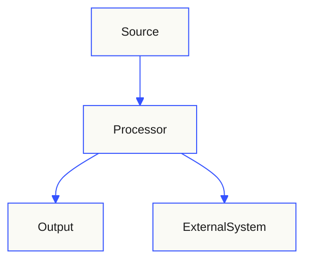
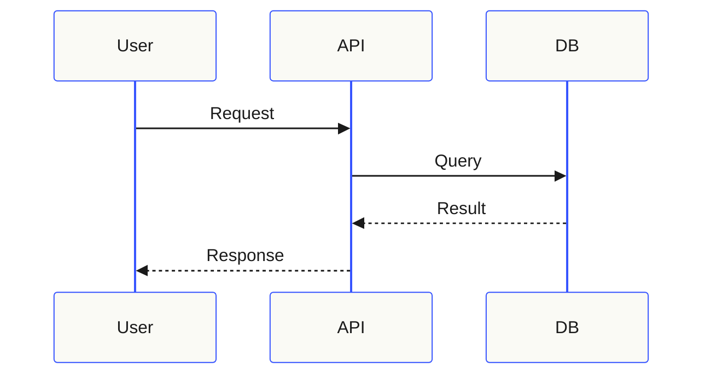
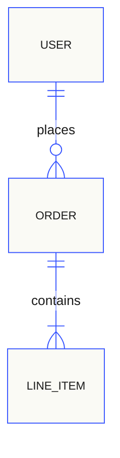
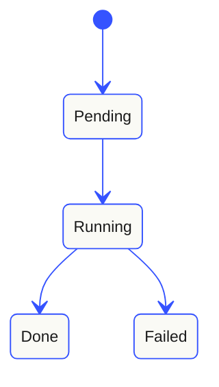
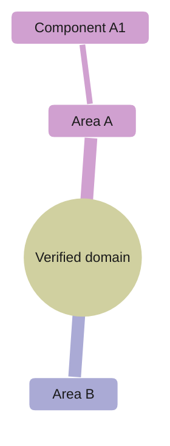

# Mermaid Diagram Standard

Use Mermaid diagrams only when they make a verified system, relationship, or
workflow easier to understand. Every diagram in `docs/` must start with this
exact init block; do not use Mermaid's default theme.

```text
%%{init: {'theme':'base','themeVariables':{'primaryColor':'#fafaf5','primaryTextColor':'#1a1a1a','primaryBorderColor':'#3553ff','lineColor':'#3553ff','fontFamily':'JetBrains Mono','fontSize':'12px'}}}%%
```

## Readability and diagram choice

- Every generated `docs/architecture.md` includes at least one compact,
  evidence-based high-level overview diagram.
- Prefer `flowchart TB` (top-to-bottom) for overviews and workflows. Use
  another direction only when it makes a short, inherently horizontal view
  clearer.
- Aim for about 5–8 meaningful nodes per view, use short labels, and omit
  implementation details that do not help answer the diagram's question.
- Keep one concern per diagram. Split large systems by boundary or workflow
  instead of making one dense diagram; each should be readable in a normal
  GitHub or Markdown preview without zooming.
- Add a workflow flowchart only for a non-trivial verified process; add a
  `sequenceDiagram` only when ordering between participants matters; use a
  `mindmap` only when a real hierarchy is clearer than connections or steps.
  These are selective additions, not a checklist to fill.
- Never invent components, actors, transitions, or integrations to complete a
  diagram. If no meaningful architecture relationships can be verified, omit
  the Architecture document rather than drawing a decorative diagram.

## Flowchart



This is a syntax example only. Replace every node and edge with verified
repository facts. Keep labels short; use subgraphs only when a clear trust,
deployment, or ownership boundary improves understanding.

## Sequence diagram

Use this for an interaction whose order matters, not as a second copy of the
overview. Keep only the participants and messages needed to explain that
interaction; sequence diagrams are naturally horizontal, so split long
interactions into separate scenarios.



## ER diagram



## State diagram



## Mind map

Use a mind map only for a verified hierarchy such as product areas or
repository domains. It is not a substitute for showing runtime connections or
workflow order. Keep the hierarchy shallow and concise.



## References

- [Mermaid flowchart syntax](https://mermaid.js.org/syntax/flowchart.html)
- [Mermaid mind map syntax](https://mermaid.js.org/syntax/mindmap.html)
- [GitHub: creating diagrams](https://docs.github.com/en/get-started/writing-on-github/working-with-advanced-formatting/creating-diagrams)
