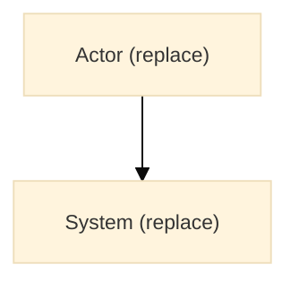

# Architecture

> Generate this document for repositories with multiple components, data
> flows, deployment topology, or pipeline stages. Derive every component and
> connection from active code or configuration. Use ISO/IEC/IEEE 42010
> concerns and viewpoints; C4-style context, container, and component views
> may structure the description.

## Overview

{{HIGH_LEVEL_SUMMARY}}

### Stakeholders and concerns

| Stakeholder                       | Concern                       | Addressed by                         |
| --------------------------------- | ----------------------------- | ------------------------------------ |
| {{STAKEHOLDER_OR_NOT_DOCUMENTED}} | {{QUALITY_ATTRIBUTE_OR_RISK}} | {{DOCUMENT_SECTION_OR_NOT_ASSESSED}} |

## System Context

Every generated architecture document must include at least one compact,
evidence-based high-level diagram. Start from this block and keep the init line:

Replace the example nodes with the main actors, components, and relationships
verified in active code or configuration, and keep labels short. A Mermaid block
is rendered as written, so a template token inside it breaks the page instead of
marking a gap. If no meaningful relationships are evidenced, do not invent them;
omit this document and explain why.

Add separate diagrams only when they clarify verified behavior: a flowchart
for a non-trivial workflow, a sequence diagram for a time-ordered interaction,
or a mind map for a genuine hierarchy. Keep each diagram focused, use short
labels, and aim for about 5–8 nodes. Split by boundary or concern when a view
would be too wide or dense to read at normal GitHub / Markdown preview size; do
not combine the whole system into one diagram, and start every additional
diagram with the same init line.

## Containers and Components

| Component     | Responsibility    | Technology        | Interfaces                     |
| ------------- | ----------------- | ----------------- | ------------------------------ |
| {{COMPONENT}} | {{VERIFIED_ROLE}} | {{VERIFIED_TECH}} | {{VERIFIED_INTERFACE_OR_NONE}} |

## Interfaces and Data Flow

{{DOCUMENT_ONLY_VERIFIED_APIS_EVENTS_STORAGE_AND_EXTERNAL_CONNECTIONS}}

| Interface     | Direction                          | Protocol / schema                 | Authentication                            |
| ------------- | ---------------------------------- | --------------------------------- | ----------------------------------------- |
| {{INTERFACE}} | {{INBOUND_OUTBOUND_BIDIRECTIONAL}} | {{VERIFIED_PROTOCOL_AND_VERSION}} | {{CONFIRMED_MECHANISM_OR_NOT_DOCUMENTED}} |

## Data Architecture

| Data store        | Data class         | Retention / backup              |
| ----------------- | ------------------ | ------------------------------- |
| {{STORE_OR_NONE}} | {{CLASSIFICATION}} | {{CONFIRMED_OR_NOT_DOCUMENTED}} |

Describe consistency, migration, and deletion behavior only where verified.

## Quality Attributes

| Attribute                  | Requirement                                | Architectural mechanism |
| -------------------------- | ------------------------------------------ | ----------------------- |
| Availability / reliability | {{CONFIRMED_TARGET_OR_NOT_DECIDED}}        | {{MECHANISM_OR_NONE}}   |
| Performance / capacity     | {{CONFIRMED_BUDGET_OR_NOT_DECIDED}}        | {{MECHANISM_OR_NONE}}   |
| Security                   | {{CONFIRMED_CONTROL_OR_NOT_ASSESSED}}      | {{MECHANISM_OR_NONE}}   |
| Privacy                    | {{CONFIRMED_OBLIGATION_OR_NOT_DOCUMENTED}} | {{MECHANISM_OR_NONE}}   |
| Observability              | {{REQUIRED_SIGNALS_OR_NOT_DECIDED}}        | {{MECHANISM_OR_NONE}}   |
| Maintainability            | {{CONFIGURED_CHECKS_OR_NOT_DOCUMENTED}}    | {{MECHANISM_OR_NONE}}   |

Do not invent numeric thresholds. Mark unconfirmed qualities `Not decided` or
`Not assessed`.

## Deployment and Environments

| Environment | Deployment mechanism     | Configuration source                      |
| ----------- | ------------------------ | ----------------------------------------- |
| {{TARGET}}  | {{CONFIGURED_MECHANISM}} | {{CONFIG_PATH_OR_SECRET_STORE_REFERENCE}} |

Include network boundaries, ingress/egress, identity, and secret-delivery
paths where verified. Never record secret values or internal hostnames that
are not already appropriate for the document's classification.

## Security Boundaries

Summarize only architecture-level boundaries visible in configuration or
implementation. See `security.md` for the repository security
posture. Identify trust boundaries, authentication/authorization enforcement
points, and data flows that cross them.

## Operations and Recovery

- Health checks and readiness signals: {{VERIFIED_OR_NOT_CONFIGURED}}
- Metrics, logs, and traces: {{VERIFIED_OR_NOT_CONFIGURED}}
- Backup and restore procedure: {{VERIFIED_OR_NOT_DOCUMENTED}}
- Recovery objectives (RTO/RPO): {{CONFIRMED_OR_NOT_DECIDED}}
- Capacity and scaling assumptions: {{VERIFIED_OR_NOT_DOCUMENTED}}
- Runbooks: {{LINK_OR_NOT_DOCUMENTED}}

## Decisions

See `decisions.md` for permanent D-IDs, rationale, and
alternatives. Do not maintain a second decision register here.

---

### Related Docs

{{RELATED_DOC_LINKS_TO_EXISTING_FILES_OR_NONE}}
